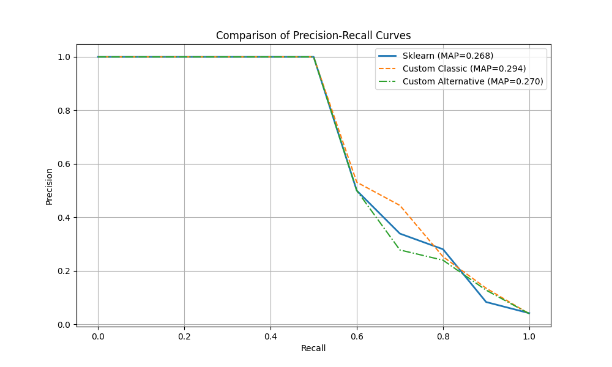
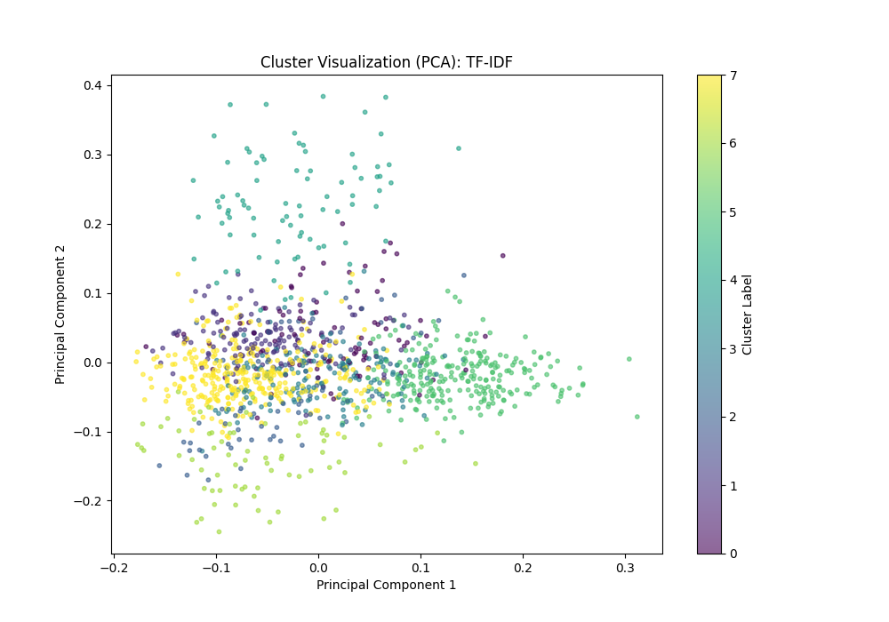
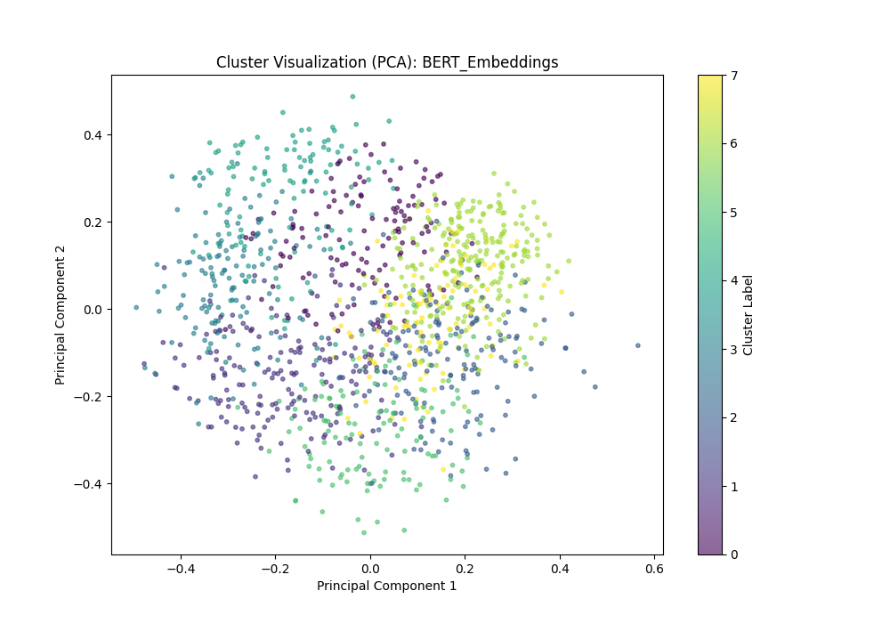

# Vector Space Search Engine for Biomedical Literature

A from-scratch information retrieval engine built on the classic **Cystic Fibrosis (CF) test collection**: an inverted index, a Vector Space Model with two term-weighting schemes, and a hand-written evaluation suite. It is benchmarked against a grid-searched scikit-learn `TfidfVectorizer`, and the document collection is clustered with both sparse TF-IDF vectors and dense transformer embeddings.

**Highlights**

- The hand-built VSM **beats the tuned scikit-learn baseline** on MAP (0.294 vs 0.268) and on P@10 (0.455 vs 0.415).
- A 36-configuration hyperparameter search over `TfidfVectorizer` (n-grams, `min_df`, `max_df`, sublinear TF).
- Every retrieval metric (Precision, Recall, F1, P@k, MAP, interpolated 11-point PR curves) is written without IR libraries.
- Clustering compares TF-IDF against `all-MiniLM-L6-v2` sentence embeddings. Embeddings give clusters that are about **7× better separated** (by silhouette score).

---

## The dataset

The [Cystic Fibrosis collection](https://people.ischool.berkeley.edu/~hearst/irbook/cfc.html) (Shaw et al., 1991) is a standard IR benchmark of medical abstracts about cystic fibrosis.

| | |
|---|---|
| Documents | 1,239 IDs, of which 1,199 are present (IDs 100–139 are missing) |
| Queries used | 20 natural-language questions, e.g. *"What is the role of aerosols in the treatment of lung disease in CF patients"* |
| Relevance judgements | Expert-assessed relevant-document lists per query |

Each missing document is skipped, and every remaining document keeps its **original numeric ID**, so the IDs in the index always match the IDs in `Relevant.txt`.

## How it works

```
collection/docs ──► indexing.py ──► inverted index ──► vector_space_model.py ──► ranked results
                     (tokenise,       {term: [[doc_id, tf], ...]}   (tf-idf weighting,          │
                      stop words,                                   cosine similarity)           ▼
                      stemming)                                                         evaluation.py
                                                                                     (P, R, F1, P@k, PR)
```

### 1. Preprocessing and indexing ([indexing.py](indexing.py))
- Lowercasing, punctuation stripping and whitespace tokenisation
- Removal of a small stop-word list
- Light suffix stemming (plural `-s` removal for tokens longer than 3 characters)
- An **inverted index** stored as `term → [[doc_id, term_frequency], ...]`. This is the minimum that tf-idf scoring needs, and a query only touches the postings for its own terms.

### 2. Vector Space Model ([vector_space_model.py](vector_space_model.py))
Two term-weighting schemes, following Salton & Buckley (1988):

| Scheme | Weight |
|---|---|
| **Classic** | `tf × log10(N / df)` |
| **Alternative** (log-normalised) | `(1 + log10(tf)) × log10(N / df)` |

Scores are built term-at-a-time by walking the postings lists. Each document is scored by its **cosine similarity** to the query (the dot product divided by the query and document vector lengths), and the documents are returned in ranked order.

### 3. Evaluation ([evaluation.py](evaluation.py), [benchmark.py](benchmark.py))
Precision, Recall, F1, Precision@k, Average Precision / MAP, and 11-point interpolated precision–recall curves, all implemented directly.

### 4. Hyperparameter search ([benchmark.py](benchmark.py))
A manual grid search over 36 `TfidfVectorizer` configurations:

| Parameter | Values |
|---|---|
| `ngram_range` | (1,1), (1,2) |
| `min_df` | 1, 2, 5 |
| `max_df` | 0.8, 0.9, 1.0 |
| `sublinear_tf` | True, False |

The best configuration is chosen by MAP, with P@10 as the tie-breaker.

### 5. Document clustering ([clustering.py](clustering.py))
K-Means on two representations of the collection:
- **Sparse:** the tuned TF-IDF vectors
- **Dense:** `sentence-transformers/all-MiniLM-L6-v2` embeddings

`k` is chosen by silhouette score over k = 2…8, and the clusters are projected to 2-D with PCA for plotting.

---

## Results

### Retrieval: hand-built VSM vs tuned scikit-learn
Averaged over the 20 queries:

| Model | MAP | P@10 | Index time | Search time (20 queries) |
|---|---|---|---|---|
| scikit-learn `TfidfVectorizer` (tuned) | 0.268 | 0.415 | 37 ms | 4 ms |
| **Custom VSM, classic tf-idf** | **0.294** | **0.455** | 23 ms | 34 s |
| Custom VSM, log-tf | 0.270 | 0.430 | 23 ms | 34 s |

Best scikit-learn configuration: `ngram_range=(1,1), min_df=1, max_df=0.8, sublinear_tf=True`.



**Observations**
- **Bigrams did not help.** Every `(1,2)` configuration scored lower than its unigram counterpart, because on a corpus this small most bigrams are too sparse to carry signal.
- **`min_df=5` hurt the most.** It removed rare but highly discriminative medical terms, and MAP fell from about 0.27 to about 0.17.
- **Sublinear TF won consistently in the scikit-learn search.** In the custom VSM, though, classic raw-tf weighting came out ahead of log-tf (MAP 0.294 vs 0.270), so the benefit of dampening term frequency depends on the rest of the pipeline.
- **The custom pipeline outperformed scikit-learn's.** Two likely reasons: its stop-word list is far smaller than scikit-learn's English list, so it keeps more terms, and its plural stemming merges forms such as *patient/patients*.
- F1 is low for every model (about 0.07) because it is computed over the *full* ranked list. Recall is high and precision is diluted, so MAP and P@10 are the meaningful ranking metrics here.

### Clustering: TF-IDF vs transformer embeddings

| Representation | Best k | Silhouette |
|---|---|---|
| TF-IDF (sparse) | 8 | 0.008 |
| MiniLM embeddings (dense) | 8 | 0.056 |

| TF-IDF | MiniLM embeddings |
|---|---|
|  |  |

Dense embeddings produce clearly better-separated clusters. TF-IDF vectors in a space of more than 10k dimensions are almost orthogonal to each other, which pushes silhouette scores towards zero. Both silhouette curves still rise at k = 8, the top of the search range, so the collection probably has finer-grained structure that a larger `k` would show.

---

## Getting started

```bash
git clone https://github.com/kostasloukanaris/IR-Project.git
cd IR-Project
python -m venv venv && source venv/bin/activate
pip install -r requirements.txt
```

| Command | What it does |
|---|---|
| `python search_demo.py` | Runs query #1 through the custom VSM, prints the top 10 results and their metrics, and saves a PR curve |
| `python benchmark.py` | Runs the 36-config grid search, then a three-way comparison with timings; saves `results/model_comparison_pr.png` |
| `python clustering.py` | Runs TF-IDF and embedding clustering and saves the plots to `results/clustering/`. The first run downloads the MiniLM model. |

## Project structure

```
├── indexing.py             # document loading, preprocessing, inverted index
├── vector_space_model.py   # VSM with classic and log-tf weighting
├── evaluation.py           # Precision, Recall, F1, P@k, PR-curve plotting
├── search_demo.py          # single-query walkthrough
├── benchmark.py            # TfidfVectorizer grid search + model comparison
├── clustering.py           # K-Means on TF-IDF vs sentence embeddings
├── collection/             # CF corpus: docs/, Queries.txt, Relevant.txt
└── results/                # generated plots
```

## References

- W. M. Shaw, J. B. Wood, R. E. Wood, H. R. Tibbo. *The Cystic Fibrosis Database: Content and Research Opportunities.* LISR 13, 1991.
- G. Salton, C. Buckley. *Term-weighting approaches in automatic text retrieval.* Information Processing & Management 24(5), 1988.
- G. Salton, A. Wong, C. S. Yang. *A vector space model for automatic indexing.* Communications of the ACM 18(11), 1975.
